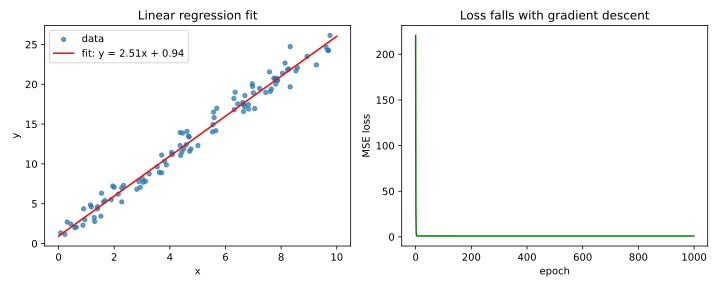

# Day 1 — Linear Regression from Scratch (NumPy)

Linear regression implemented from scratch with NumPy — no scikit-learn.
We fit a line `y = m*x + b` to data using gradient descent.

## The maths (short version)

- Model: `y_hat = m * x + b`
- Cost (mean squared error): `J = (1/n) * sum((y_hat - y)^2)`
- Gradients: `dm = (2/n) * sum((y_hat - y) * x)`, `db = (2/n) * sum(y_hat - y)`
- Update: `m -= lr * dm`, `b -= lr * db`, repeated until the cost stops falling.

## How to run

```bash
pip install numpy matplotlib
python linear_regression.py
```

## Data

100 synthetic points, `y = 2.5x + 1.0 + noise`, seed 42 — so anyone running
this gets the exact same numbers.

## Results

- Learned slope (m): 2.5085 (true: 2.5)
- Learned intercept (b): 0.9436 (true: 1.0)
- Final MSE: 0.9589
- R²: 0.9798



The line recovers the true slope and intercept closely, and R² ≈ 0.98 means
the line explains about 98% of the variation in the data.
