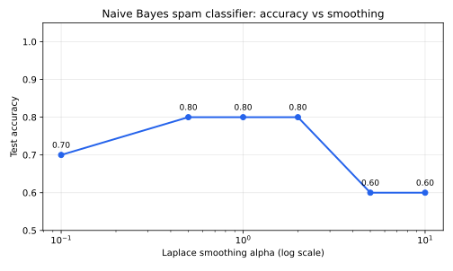

# Day 3 — Naive Bayes Text Classifier from Scratch

A spam/ham SMS classifier built with NumPy only — no scikit-learn.
It learns which words tip a message towards spam and which towards ham,
then classifies new messages with Bayes' rule.

## The idea

Each message is a bag of words: word order is ignored, only counts matter.
For a message with words $w_1 \dots w_n$, the class is the one with the
higher posterior probability:

$$P(\text{class} \mid \text{words}) \propto P(\text{class}) \prod_i P(w_i \mid \text{class})$$

The "naive" part is assuming words are independent given the class — clearly
false for real language ("free" and "prize" travel together), but it works
surprisingly well for short texts and it is fast and easy to reason about.

$P(w \mid \text{class})$ is estimated by counting: how often word $w$ appears
in spam messages, divided by the total word count of all spam messages.
Words never seen in a class would get probability zero and kill the whole
product, so **Laplace (add-one) smoothing** adds 1 to every word count first:

$$P(w \mid \text{class}) = \frac{\text{count}(w, \text{class}) + \alpha}{\sum_w \text{count}(w, \text{class}) + \alpha \cdot |V|}$$

All computation is done in log space, so multiplying many small
probabilities becomes adding logs — no underflow.

## The data

40 short SMS-style messages written for this project: 20 spam, 20 ham.
Split 30 train / 10 test with seed 42 (reproducible). Vocabulary: 161 words.

## How to run

```bash
python naive_bayes.py   # trains and evaluates, prints results
python plot.py          # accuracy vs smoothing alpha -> accuracy_vs_alpha.svg
```

## Results (measured, seed 42)

| Metric | Value |
|--------|-------|
| Test accuracy | **0.80** (8/10 correct) |
| Confusion matrix | TP = 5, TN = 3, FP = 0, FN = 2 |
| Vocabulary | 161 words |

No false positives — no ham message was flagged as spam — but two spam
messages slipped through (FN = 2). On a 10-message test set that is one
message either way, so the headline number is noisy; the interesting part is
*which* words the model leans on.

Most spam-indicative words (log-odds): `now` (+2.07), `won`, `one`, `claim`,
`prize` (+1.51 each), `click`, `congratulations`, `earn` (+1.22).
Most ham-indicative: `the` (+1.42), `me`, `evening`, `please`, `i` (+1.26) —
everyday words, which is exactly why spam filters look for the *absence* of
normal language as much as the presence of spammy words.

Accuracy vs Laplace smoothing $\alpha$ (test set):

| α | 0.1 | 0.5 | 1.0 | 2.0 | 5.0 | 10.0 |
|---|-----|-----|-----|-----|-----|------|
| Accuracy | 0.70 | 0.80 | 0.80 | 0.80 | 0.60 | 0.60 |

Too little smoothing (α = 0.1) lets rare words dominate; too much (α ≥ 5)
washes out the signal and the model drifts towards the prior. The flat
plateau at α = 0.5–2.0 is typical — Naive Bayes is not very sensitive to α
in the middle range.



## What I learned

- Bag-of-words + Naive Bayes is a genuinely useful baseline: 80% on a tiny
  hand-written dataset with ~30 lines of maths.
- Smoothing is not a fudge factor — without it, one unseen word zeroes the
  whole document probability.
- Small test sets lie: 8/10 sounds good, but two errors is a wide confidence
  interval. More data beats a fancier model here.
