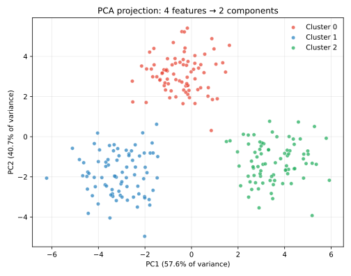
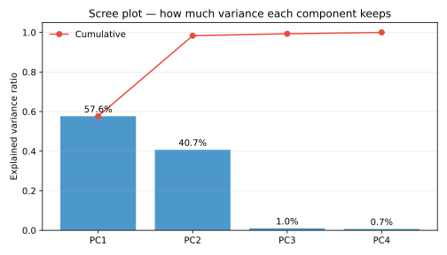

# Day 4 — Principal Component Analysis (PCA) from Scratch

A from-scratch PCA built with NumPy only — no scikit-learn. A 4-feature
dataset is really driven by 2 hidden factors; PCA finds the directions
along which the data varies most and compresses 4 numbers down to 2
while keeping almost all of the information.

## The idea

PCA asks: along which directions does this data spread out the most?
Those directions are the eigenvectors of the covariance matrix, and how
much variance each one explains is its eigenvalue:

$$\Sigma \, v = \lambda \, v$$

where $\Sigma$ is the covariance matrix, $v$ is a principal component
(a direction), and $\lambda$ is the variance along it. The steps:

1. **Centre** the data (subtract the mean of each feature).
2. **Covariance matrix** — how every pair of features varies together.
3. **Eigendecomposition** — `np.linalg.eigh` (the matrix is symmetric,
   so all eigenvalues are real).
4. **Sort** eigenvalues descending; the top eigenvectors are the
   principal components.
5. **Project** — dot the centred data with the top-$k$ eigenvectors.

The fraction of total variance kept by component $i$ is
$\lambda_i / \sum_j \lambda_j$. If the first few components already
cover ~95%+, the rest is mostly noise and can be dropped.

The features here share the same scale (all built from the same latent
factors plus equal noise), so PCA on the covariance matrix is the right
call. If features lived on wildly different scales (say, age in years
vs salary in rupees), standardising first (PCA on the correlation
matrix) would be the honest version — otherwise the big-scale feature
dominates the components just by being big.

## The data

240 synthetic points in 4 features, seed 42 (reproducible): 3 clusters
of 80 points. Each point is built from 2 hidden factors mixed into 4
observed features through a fixed loading matrix, plus small noise —
so the features are correlated, which is exactly what PCA exploits.

## How to run

```bash
python pca.py   # runs PCA, prints results, saves projection.svg + scree.svg
```

## Results (measured, seed 42)

| Metric | Value |
|--------|-------|
| Explained variance ratio | PC1 **57.65%**, PC2 **40.69%**, PC3 0.99%, PC4 0.68% |
| Variance kept by PC1 + PC2 | **98.33%** |
| Reconstruction MSE, 2 PCs | **0.0607** |
| Reconstruction MSE, 4 PCs | 0.0000 (lossless, as expected) |
| Nearest-centroid accuracy in 2-D projection | **0.9958** (239/240) |

The first two components keep 98.33% of the variance — the data really
was 2-dimensional hiding inside 4 features, and PCA found it. Dropping
from 4 numbers to 2 costs almost nothing: the rebuild error is just
0.0607, and the three clusters stay almost perfectly separable in the
2-D projection (239 of 240 points land nearest their own cluster's
centre).

The scree plot makes the elbow obvious: PC1 and PC2 tower over PC3 and
PC4, which carry under 1% each — pure noise directions.





Top-2 principal components (rows = original features):

| Feature | PC1 | PC2 |
|---------|-----|-----|
| 0 | −0.229 | −0.711 |
| 1 | −0.560 | −0.337 |
| 2 | +0.433 | −0.601 |
| 3 | +0.668 | −0.137 |

## What I learned

- PCA is just eigendecomposition of the covariance matrix — the "magic"
  is that the directions of maximum variance are the eigenvectors, and
  the eigenvalues tell you exactly how much each direction matters.
- The scree plot is the decision tool: keep components until the
  cumulative variance flattens out. Here the elbow after PC2 is dramatic.
- Compression is not free, but it can be nearly free: 4 → 2 features
  kept 98% of the variance and 99.6% cluster separability.
- Scale matters: PCA on raw covariance trusts the units. Standardise
  first when features are measured on different scales, or one feature
  will hijack the components.
