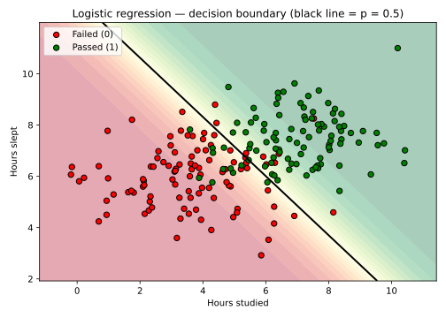
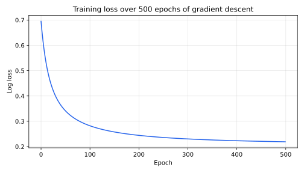

# Day 5 — Logistic Regression from Scratch

**Topic:** Supervised learning · binary classification · gradient descent

## The idea

Linear regression (Day 1) predicts a continuous number. Logistic regression
answers **yes/no** questions instead — will this student pass? Is this email
spam? It predicts a *probability* between 0 and 1, then thresholds at 0.5.

## The maths in brief

For an input `x = (x1, x2)`, first compute a linear score

```
z = w1·x1 + w2·x2 + b
```

then squash it through the sigmoid function

```
p = sigmoid(z) = 1 / (1 + e^(−z))
```

so `p` is always in (0, 1) and reads as **P(y = 1 | x)**.

Fit `w` and `b` by minimising binary cross-entropy (log loss):

```
L = −(1/n) · Σ [ y·log(p) + (1−y)·log(1−p) ]
```

Its gradients have the same neat form as linear regression:

```
dL/dw = (1/n) · Xᵀ(p − y),   dL/db = (1/n) · Σ(p − y)
```

so plain gradient descent works: `w -= lr · dL/dw`.

## The data

Synthetic, fixed seed (42) — reproducible. Two features for a student:
**hours studied** and **hours slept**. Two Gaussian blobs (passed vs failed)
with a little overlap so the problem is not trivially separable. 200
examples, 80/20 train/test split, features standardised using train
statistics only.

## How to run

```bash
python3 logistic_regression.py
```

NumPy + matplotlib only. Produces `decision_boundary.svg` and
`loss_curve.svg`.

## Results (measured, seed 42)

| Metric | Value |
|---|---|
| Learned weights | w1 = 2.8864, w2 = 1.4256, b = −0.1266 |
| Log loss | 0.6949 → **0.2189** over 500 epochs |
| Train accuracy | **91.2%** (160 examples) |
| Test accuracy | **82.5%** (40 examples) |
| Test confusion matrix | TP = 15, TN = 18, FP = 2, FN = 5 |
| Test precision / recall | 0.882 / 0.750 |

The weights make sense: hours studied (w1) matters roughly twice as much
as hours slept (w2). Test accuracy is lower than train accuracy — the
blobs overlap, so a few borderline students are genuinely hard to call,
and with only 40 test examples each mistake costs 2.5%.

## Plots



*The black line is the p = 0.5 decision boundary; the coloured background
is the predicted probability.*



*Log loss falls steeply in the first ~50 epochs, then levels off — the
classic gradient-descent shape.*

## What I learned

- Logistic regression is linear regression plus a sigmoid — the same
  gradient-descent machinery, a different loss and a different question.
- The gradient `(p − y)` is intuitive: the model only updates where its
  probability disagrees with the label.
- Accuracy alone hides the story: the confusion matrix shows the model
  misses more passes (FN = 5) than it over-predicts (FP = 2).
